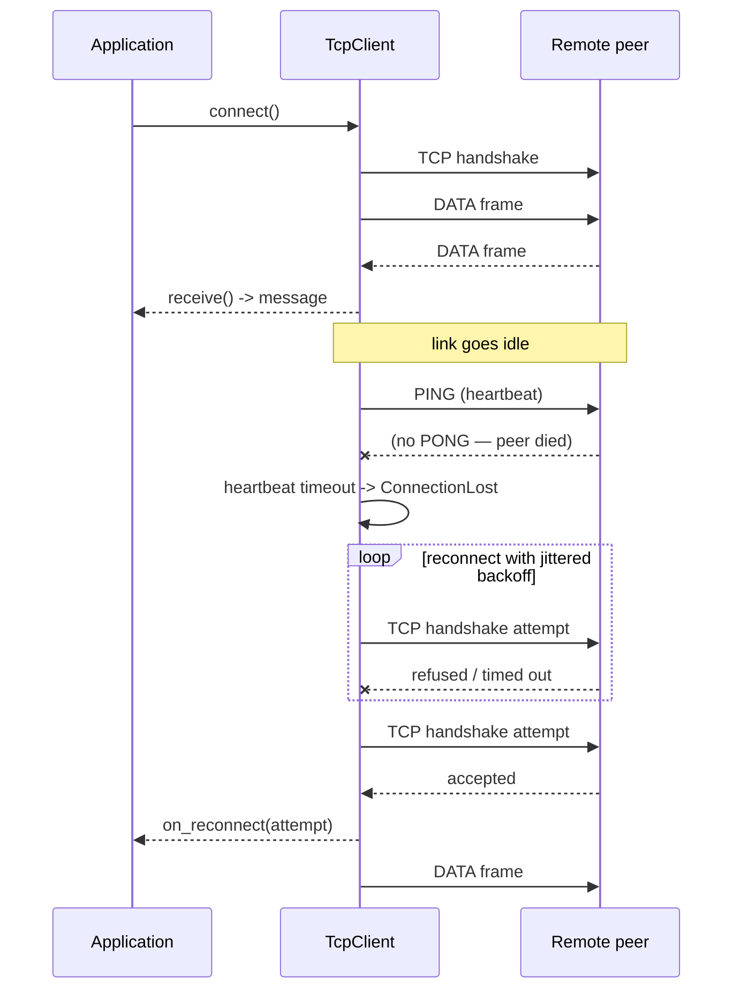
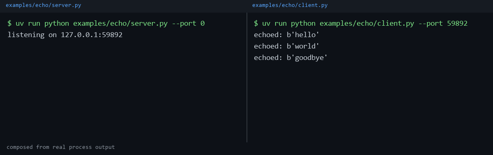

# tcp-ip-connector

[](https://github.com/lucas-lima-s/tcp-ip-connector/actions/workflows/ci.yml)

[](LICENSE)


A dependency-free Python TCP library with a symmetric sync and asyncio API,
pluggable framing and checksums, auto-reconnect with jittered backoff, and
application-level heartbeats.

```
pip install tcpconn
```

```python
import tcpconn as t

print(t.__version__)
```

The distribution on PyPI is `tcpconn`; the import package is also `tcpconn`
(the *repository* is named `tcp-ip-connector` for discoverability — the two
names are deliberately different).

## Why

Most hand-rolled TCP code repeats the same four mistakes:

1. **Ignoring the return value of `send`.** `socket.send(data)` may transmit
   *fewer* bytes than given and returns how many. Code that ignores the
   return value silently truncates writes under load. The fix is
   `sendall`, or looping until everything is sent.
2. **Assuming `recv(n)` returns exactly `n` bytes.** TCP is a byte stream,
   not a message stream — a 4-byte header can arrive as 1 byte then 3, or
   in a hundred single-byte chunks. Code that indexes straight into the
   result of one `recv` call is one slow network away from a crash or,
   worse, silent corruption.
3. **No error taxonomy.** A `recv` that raises because the peer reset the
   connection looks exactly like one that raises because the peer merely
   went quiet — unless the caller a) has a timeout and b) can tell "closed"
   from "still open but idle" from "corrupt".
4. **No reconnect, no context manager.** One exception and the whole
   client is dead: no automatic retry, no backoff, no way to resume.

`tcpconn` exists to get all four right by construction, with zero runtime
dependencies.

## Install

```
pip install tcpconn
pip install tcpconn[msgpack]   # adds the MessagePack codec
```

## Quick start (sync)

```python
from tcpconn.sync import TcpServer, TcpClient


def echo(conn):
    for msg in conn:
        conn.send(msg)


server = TcpServer("127.0.0.1", 0, handler=echo)
server.start()

client = TcpClient(*server.address)
client.connect()
client.send(b"hello")
print(client.receive())  # b"hello"
client.close()
server.stop()
```

## Quick start (asyncio)

```python
import asyncio
from tcpconn.aio import AsyncTcpServer, AsyncTcpClient


async def main():
    async def echo(conn):
        async for msg in conn:
            await conn.send(msg)

    server = AsyncTcpServer("127.0.0.1", 0, handler=echo)
    await server.start()

    client = AsyncTcpClient(*server.address)
    await client.connect()
    await client.send(b"hello")
    print(await client.receive())  # b"hello"
    await client.aclose()
    await server.stop()


asyncio.run(main())
```

Switching models is an import change plus `await`: the two snippets above
are structurally identical.

## Wire format

```
+------------------+----------+---------------------+--------------------+
| length: 4B big-  | kind: 1B | payload: N bytes    | checksum: 1B or 4B |
| endian unsigned  |          |                     | (optional layer)   |
+------------------+----------+---------------------+--------------------+
  length counts everything after itself: kind + payload + checksum
```

| kind byte | name | meaning                                              |
|-----------|------|-------------------------------------------------------|
| `0x00`    | DATA | An application message, decoded by the configured codec. |
| `0x01`    | PING | Sent by an idle peer to prove liveness.               |
| `0x02`    | PONG | Sent in immediate reply to a PING.                    |

The `kind` byte is the **control channel**: it lives one layer above framing
and is what makes heartbeats an explicit protocol feature instead of a
magic payload that could collide with real application data. It can be
switched off with `control_channel=False`, in which case `tcpconn` frames
look exactly like plain length-prefixed messages (interoperable with a
non-`tcpconn` peer that speaks the same length-prefix convention) — but
heartbeats become unavailable: constructing a connection with both
`control_channel=False` and `heartbeat=...` raises `ValueError` immediately.

When a checksum is configured, it is computed over `kind + payload` and
appended *inside* the length-prefixed body, so a plain length-prefix reader
on the other end still parses the frame correctly; it just sees the
checksum bytes as part of the payload.

## Framing

The single most important design decision in this library: a `Framer`'s
decoder is a **pure, incremental, feed-based** state machine.

```python
class FrameDecoder(Protocol):
    def feed(self, data: bytes, /) -> list[bytes]: ...
```

`feed(chunk)` accepts an arbitrary slice of the byte stream — one byte, one
megabyte, three frames concatenated — and returns zero or more complete
payloads, buffering any remainder internally. It never reads from a socket
itself. This is what lets the sync and asyncio transports share 100% of the
parsing logic (one just calls `feed()` from a thread, the other from a
coroutine), and it is what makes short-read handling trivial to prove: feed
the encoded bytes one at a time and assert the frame still comes out whole.

`ChecksumFramer` composes over any other `Framer` as a decorator, not a
subclass:

```python
from tcpconn import ChecksumFramer, LengthPrefixFramer, Crc32

framer = ChecksumFramer(LengthPrefixFramer(), Crc32())
wire = framer.encode(b"hello")  # length-prefixed, CRC32-checked
```

Two checksums ship out of the box: `XorLrc` (1-byte XOR fold — cheap, catches
single-bit flips) and `Crc32` (4-byte, `zlib.crc32` — much stronger, still
free).

## Serialization

| Codec           | Wire payload           | Notes                                      |
|------------------|------------------------|---------------------------------------------|
| `RawCodec`       | `bytes` unchanged      | Default. `dumps` rejects non-bytes-like input. |
| `JsonCodec`      | UTF-8 JSON             | `ensure_ascii=False` by default.            |
| `MsgpackCodec`   | MessagePack            | Requires `pip install tcpconn[msgpack]`; the class exists without the extra installed, but instantiating it raises `SerializationError` if `msgpack` cannot be imported. |

## Reconnect & heartbeat

```python
from tcpconn import ExponentialBackoff, ReconnectPolicy, HeartbeatConfig

client = TcpClient(
    "example.org",
    9000,
    reconnect=ReconnectPolicy(backoff=ExponentialBackoff(initial=0.5, maximum=30.0)),
    heartbeat=HeartbeatConfig(interval=15.0, timeout=45.0),
)
```



The reconnect loop recreates the frame decoder from scratch on every
attempt — a half-parsed frame from a dead connection must never leak into
the new one.

## Errors

Every exception in `tcpconn` inherits from `TcpConnError`.

| Exception            | Raised when                                                          | What to do                                  |
|-----------------------|-----------------------------------------------------------------------|-----------------------------------------------|
| `TcpConnError`        | Base class; never raised directly.                                   | Catch it to handle any library failure.       |
| `NotConnected`        | An operation needs a live connection that does not exist yet.        | Call `connect()` first.                       |
| `ConnectionLost`      | The peer closed the connection, or a socket error tore it down.      | Reconnect, or let `ReconnectPolicy` do it.    |
| `ReceiveTimeout`      | No message arrived within the effective timeout.                     | Retry, or treat as a liveness check.          |
| `FrameError`          | The byte stream could not be parsed into a well-formed frame.        | The stream is desynchronised; reconnect.      |
| `ChecksumError`       | A frame's trailing checksum did not match its payload (subclass of `FrameError`). | Treat like any other framing failure.         |
| `SerializationError`  | A codec failed to encode or decode a message.                        | Check the payload against the codec in use.   |
| `ReconnectFailed`     | The reconnect policy exhausted its attempts (subclass of `ConnectionLost`). | Give up, or construct a fresh client.         |

## Examples

| Directory                 | What it shows                                          |
|----------------------------|---------------------------------------------------------|
| [`examples/echo`](examples/echo)             | The minimum viable client/server pair.   |
| [`examples/rpc`](examples/rpc)               | Request/response correlation with `JsonCodec` and `request()`. |
| [`examples/pubsub`](examples/pubsub)         | A broker fanning out messages to topic subscribers via `broadcast`. |
| [`examples/async_echo`](examples/async_echo) | The asyncio counterpart to the echo example.            |

See [`examples/README.md`](examples/README.md) for the exact two-terminal
commands and expected output for each one.



## Development

```
uv sync --all-groups
uv run pytest
uv run ruff check .
uv run ruff format .
uv run mypy
```

## Design notes

- **A reader thread instead of `selectors`.** The sync client owns a daemon
  thread that blocks on `recv` and feeds the decoder; this keeps the public
  API fully synchronous (`receive()` just pops a queue) without asking
  every caller to run an event loop or a `select` loop of their own. The
  asyncio client gets the same decoupling for free from `asyncio.Task`.
- **Both models exist because they solve different problems.** The sync
  API is the natural fit for a script, a test, or a thread-per-connection
  worker. The asyncio API is the natural fit for a service already built
  on an event loop. `test_interop.py` proves they are the same protocol,
  not two incompatible half-libraries: an `AsyncTcpClient` can talk to a
  `TcpServer` and vice versa.
- **Windows vs. POSIX `errno`.** A reset connection surfaces as
  `ConnectionResetError`/`ConnectionAbortedError` on both platforms, but
  the raw `errno` values differ (`WSAECONNRESET`/`WSAECONNABORTED` on
  Windows vs. `ECONNRESET`/`ECONNABORTED`/`EPIPE` on POSIX). `_socketio.py`
  normalizes every one of them to `ConnectionLost` so application code
  never has to branch on platform.
- **Coverage gate is 85, not 90.** Several OS-specific `errno` branches are
  only reachable on one platform at a time; padding the number with
  `# pragma: no cover` markers to hit a rounder target would be worse than
  an honest gate.

## License

MIT — see [LICENSE](LICENSE).
